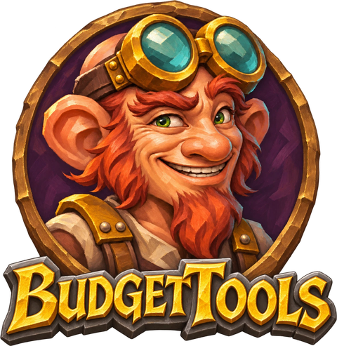

# BudgetTools

BudgetTools adds small tools to WoW Forever that the default interface lacks. You switch each one on or off in a single window, so you run the ones you use and skip the rest.

BudgetTools keeps growing: the tools get better with each update, and new ones arrive regularly.

Type `/bgt` or click the minimap button to open it.

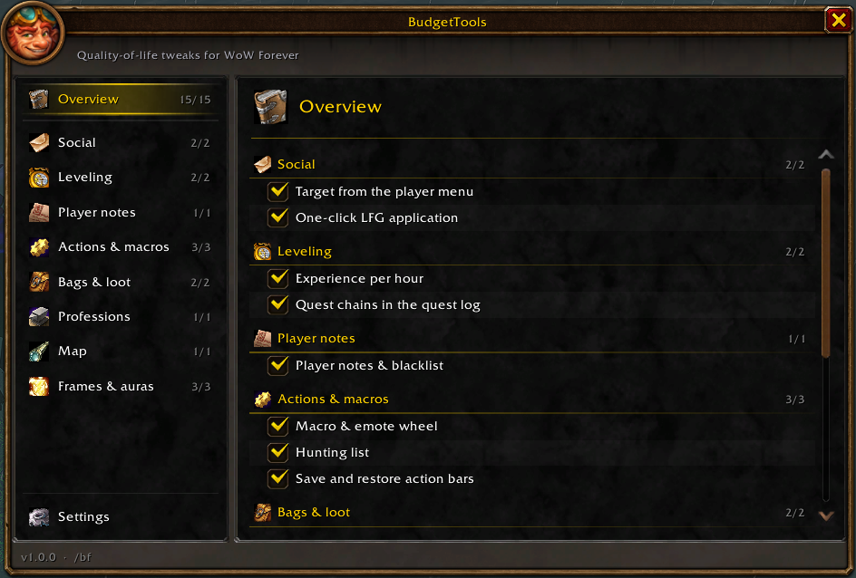

## Know who you group with

**Player notes and blacklist.** Right-click a player in chat, your friends list, the guild roster, a group frame or the target frame. Write a note, rate the player, or blacklist them. Your notes show up in tooltips and next to names in chat, and all your characters share them. For blacklisted players, you can get a warning when they join your group, decline their invites, or hide their messages.

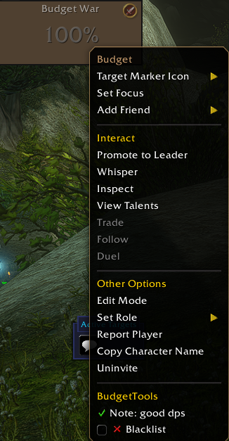 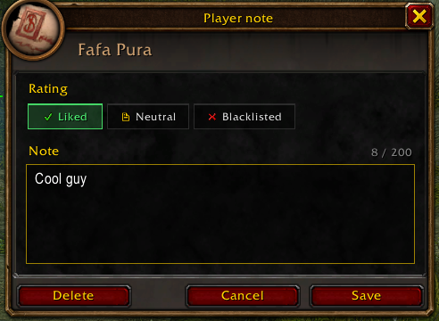

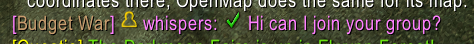

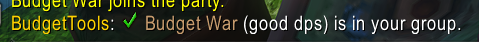

**Target from the player menu.** Right-click a name in chat, the friends list or the guild roster and pick Target. The player has to be nearby, and the game blocks this in combat.

**One-click LFG application.** Select a group in the Group Browser and click Apply. BudgetTools whispers your prepared message to the leader. The message can hold `{class}`, `{level}`, `{role}` and `{dungeon}`, and BudgetTools fills them in for each group. Groups you applied to get a mark.

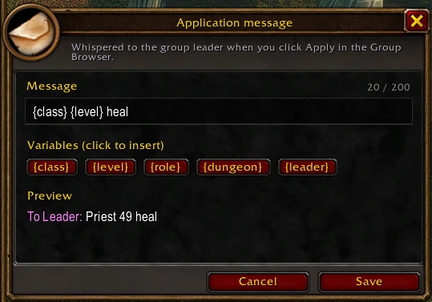

## Find things on the map

**NPC and item finder.** Type a name in the search bar on the world map, or use `/npc Name` and `/item Name`. The map shows where the NPC stands, or where the item comes from: vendors, mobs, gathering nodes and quests. Alt+click an item to look it up. Hold Shift when you pick a result to get a TomTom arrow.

The finder reads its data from the **QuestieDB** addon, so install that too. QuestieDB knows quest items, vendors and gathering nodes. Its data has gaps for random drops, raid loot and crafted items.

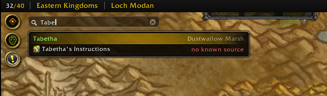

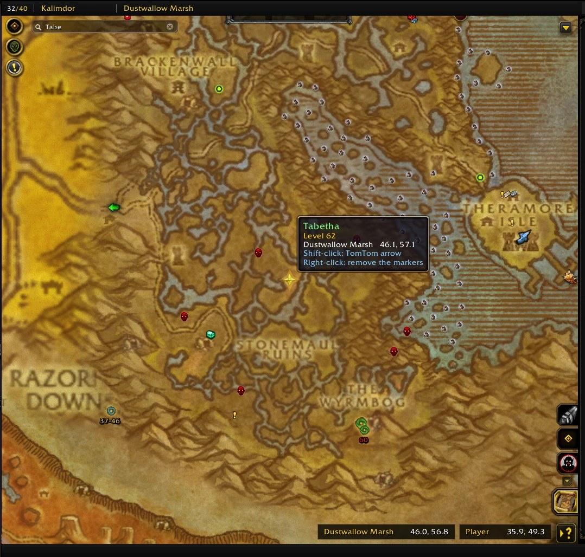

**Hunting list.** Build a list of the NPCs you are after. One key targets the most important one around you and casts your tag spell on it, so you can spam it while you ride. A sound and a taskbar flash tell you when a listed NPC shows up.

## Bags, bars and macros

**Room for loot when your bags are full.** Your bags are full and something good drops. BudgetTools offers to destroy a cheaper item so you can take the loot, grey junk first. You confirm with a click before anything goes. It leaves out blue and better items, quest items, keys, bags, lockboxes and profession tools. With Auctionator installed, it compares auction prices.

**Item type names in the combined bag.** A small name (Consumable, Weapon, Quest...) sits above the first item of each group in the combined backpack, so you see where "Clean up bags" put each kind of item. Grey items share one name, Junk. You choose the text size and how much room the rows leave for the names.

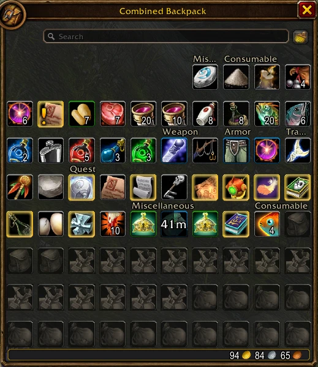

**Macro and emote wheel.** Hold a key and a wheel of up to 8 macros and emotes opens around your cursor. Move toward one and release. It works in combat.

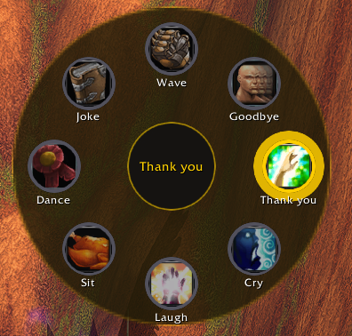 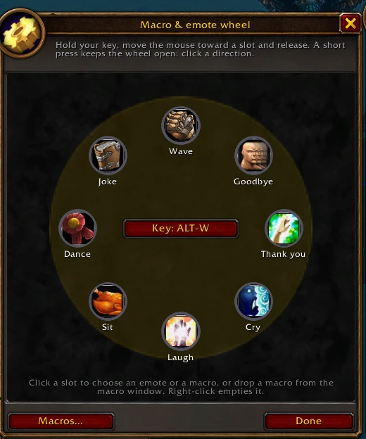

**Action bar backup.** Dual spec on WoW Forever can empty your action bars. BudgetTools keeps a copy of your bars for each spec and puts back the actions the game loses after a logout, a reload or a spec swap. It saves spells with their exact rank and waits for the end of a fight before it restores anything.

## Professions and leveling

**Pinned recipes.** Drag a recipe name out of the professions window. Its reagents stay on screen in a small note that counts them in your bags: green when you have enough, gold when your bank covers the rest, red when some are missing. Set how many crafts you want and the counts follow.

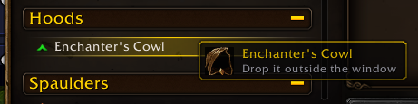

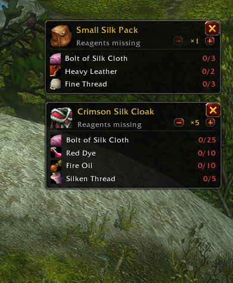

**Experience per hour.** A small box shows the XP you earn per hour this session and the time left until your next level. Right-click it to pick its lines, its size and its background.

**Quest chains in the quest log.** A quest that belongs to a chain shows its step (2/5) in the quest log. One click opens the whole chain in its own window: the quests you have done, the ones in your log and what comes next. Click any quest of the chain to see its objective, who gives it and who takes it, and to show them on the map. Needs QuestieDB.

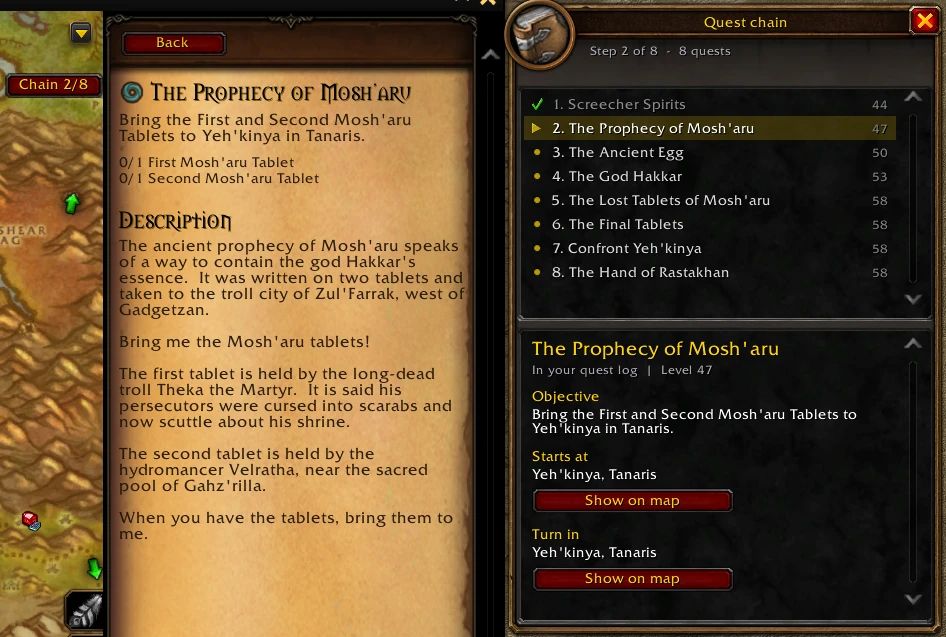

## Frames and auras

**Who cast that buff.** Buff and debuff tooltips gain a "Cast by" line with the caster's name in class color. It works on your buff bar and the party frames. Forever locks the tooltips of the target frame and the raid-style frames, so those stay as they are.

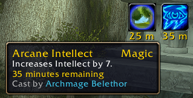

**Hide Boosted Rest on raid frames.** BudgetTools removes the Boosted Rest icon from party and raid frames, so the debuffs you need to see keep their place. The bonus itself stays on.

**Talents tab in the inspect window.** The inspect window gains a Talents tab under Character, PvP and Guild. One click opens the game's talent window on the player you are inspecting, without going back to their right-click menu. A button on the talent window brings you back to the inspect window.

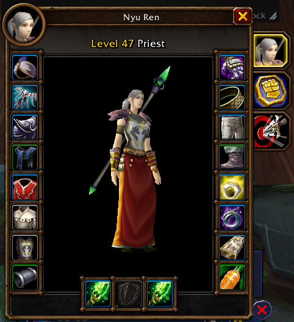

## Commands

| Command | What it does |
|---|---|
| `/bgt` | Open or close the options |
| `/bgt note Name` | Write a note about a player |
| `/bgt lfg` | Edit your LFG application message |
| `/bgt wheel` | Set up the macro and emote wheel |
| `/npc Name` | Find an NPC on the world map |
| `/item Name` | Show where an item comes from |
| `/hunt Name` | Add an NPC to your hunting list |
| `/bgt bars` | Check, save or restore your action bar copy |
| `/bgt xp` | Print your XP per hour in chat |
| `/bgt auras` | List the auras hidden on raid frames |
| `/bgt reset` | Restore the default settings (your notes and lists stay) |

## Works with

- **QuestieDB**: required for the NPC and item finder and for quest chains.
- **TomTom**: optional, for the arrow toward an NPC.
- **Auctionator**: optional, for auction prices when your bags are full.

## Languages

English and French. BudgetTools follows your game language, and you can change it in its settings.

## Install

Copy the `BudgetTools` folder into `World of Warcraft\_forever_\Interface\AddOns`, then restart the game.
